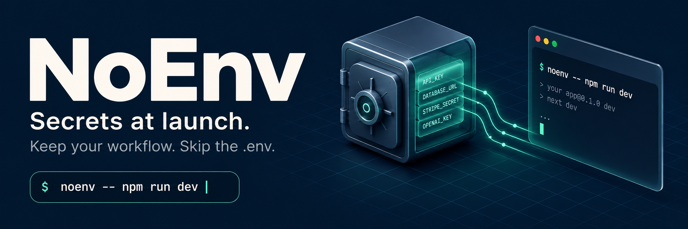
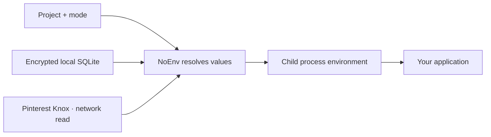

<div align="center">



<p><strong>Run commands with secrets, without committing secrets.</strong></p>
<p>Encrypted local storage. Pinterest Knox integration. One familiar command.</p>

<p>
  <a href="package.json"></a>
  <a href="https://nodejs.org/"></a>
  <a href="tsconfig.json"></a>
  <a href="https://github.com/pinterest/knox"></a>
</p>

<p>
  <a href="#quickstart">Quickstart</a> ·
  <a href="#pinterest-knox-integration">Knox integration</a> ·
  <a href="#how-it-works">How it works</a> ·
  <a href="#commands">Commands</a> ·
  <a href="#documentation">Documentation</a>
</p>

</div>

---

NoEnv resolves configuration when you launch an application and passes the values
into its environment. Keep development secrets in an encrypted local SQLite store,
or fetch them from **[Pinterest Knox](https://github.com/pinterest/knox)** using
your configured native client. Your application keeps reading ordinary environment
variables; normal launches create no plaintext `.env` file.

```sh
noenv -- npm run dev
```

**Available now:** local encrypted storage, read-only Knox, explicit modes,
dotenv migration, export, basic schemas, context rules, and diagnostics.
A NoEnv team server and additional remote providers are [planned](#roadmap).
Install from source using the steps below.

## Why NoEnv?

| Capability | What it gives you |
| --- | --- |
| **Keep your application code** | Wrap an existing command; no application SDK required |
| **Choose where values live** | Local encrypted SQLite for standalone use, or an existing Knox deployment |
| **Commit references, not values** | Share project configuration and Knox key mappings through Git |
| **Choose the environment explicitly** | Use project/mode scopes such as `local`, `dev`, and `staging` |
| **Inspect before launching** | See selected keys with `--dry-run`, provider names with `--verbose`, and context with `noenv context` |
| **Migrate incrementally** | Import an existing dotenv file and use temporary export for applications that require one |

NoEnv is a launch wrapper. It reduces plaintext-file exposure; it does not isolate
secrets from the application that receives them. See [the security model](#security-model).

## Quickstart

### 1. Install from source

Use **Node.js 24** and Git. The package declares Node >=22, but
[`node:sqlite`](https://nodejs.org/api/sqlite.html) requires at least Node 22.13
to run without its experimental flag.

```sh
git clone https://github.com/quentinmayo/noenv.git
cd noenv
npm ci
npm run build
npm link
noenv --version
```

`npm link` makes the built CLI available as `noenv`. Without linking, invoke
`node /absolute/path/to/noenv/dist/index.js`. Rebuild after TypeScript changes.
These steps do not require a published npm package.

### 2. Add local values

From **your application's directory**:

```sh
noenv init --project my-api
noenv set DATABASE_URL          # enter the value in a hidden prompt
noenv set OPENAI_API_KEY
noenv list                     # inspect names and metadata, never values
```

`init` creates `noenv.config.json`, initializes per-user key custody, and adds
ignore rules. Values are encrypted in `~/.noenv/noenv.db` by default. NoEnv prefers
the optional OS keychain binding; `noenv init --passphrase` selects a passphrase
on first setup. The database is created when the provider is first opened.

### 3. Run your application

```sh
noenv -- npm run dev
noenv --mode dev -- npm test
noenv --mode dev -- python -m uvicorn app:app
```

The wrapped program must already be installed in your application environment.
Stored values override matching inherited environment variables; normal child
exit codes and terminal input/output are preserved.

> [!TIP]
> Already using Knox? Go straight to the [Knox setup](#pinterest-knox-integration).
> A Knox-only project needs no local NoEnv database, keychain, or `noenv init`.

### Migrating an existing `.env`

```sh
noenv import .env --mode local
noenv list --mode local
noenv --mode local -- npm run dev
# After verifying the application works:
rm .env
```

Import encrypts the values and adds an ignore entry. It does not delete the
source or remove Git history. Rotate any real credentials that were committed.

## Pinterest Knox integration

**[Pinterest Knox](https://github.com/pinterest/knox)** is an open-source secret
management service with versioning and rotation. NoEnv connects it to everyday
application commands through a read-only provider: Knox owns the secret lifecycle,
while NoEnv resolves values and delivers them at launch.

**[Explore pinterest/knox →](https://github.com/pinterest/knox)** ·
**[Read the complete integration guide →](docs/providers/knox.md)**

### Configure references, then run

First install and configure a trusted native Knox client for your deployment.
Create this `noenv.config.json` in the application directory, replacing the example
key IDs with existing keys your client can access:

```json
{
  "project": "my-api",
  "defaultMode": "dev",
  "providers": [
    {
      "name": "team-knox",
      "type": "knox",
      "command": "knox",
      "timeoutMs": 10000,
      "projects": {
        "my-api": {
          "dev": {
            "DATABASE_URL": "my_api:dev:database_url",
            "OPENAI_API_KEY": "my_api:dev:openai_api_key"
          }
        }
      }
    }
  ]
}
```

```sh
noenv list --mode dev
noenv get DATABASE_URL --mode dev --redact
noenv --mode dev -- npm run dev
```

The adapter invokes `knox get -n` with separate arguments and no shell. It bypasses
the client file cache, reads the current primary version, and keeps the returned
value in memory for injection. A missing mapped key, unknown scope, timeout, or
failed client read prevents launch. Promote a version in Knox and restart your
command to pick up the new value.

**Live-tested:** retrieval, injection, version promotion, failure handling, and
disposable-key cleanup against a TLS-enabled Knox LAN deployment on macOS ARM64.
That deployment uses a shared LAN administrator identity; other authentication
configurations and native Windows execution have not been live-validated.

### Choose your provider

| | Local SQLite | Pinterest Knox |
| --- | --- | --- |
| Values live in | An encrypted per-user database | Your existing Knox deployment |
| Setup | `noenv init` | Configured Knox client + project mappings |
| Key/access management | OS keychain or passphrase-derived key | Your Knox deployment's controls |
| Writes | `noenv set`, `import`, `remove` | Knox tooling; NoEnv's adapter is read-only |
| Remote dependency | None for local resolution | A network read for each mapped key |
| Rotation visibility | Next launch after a local update | Next launch after a version is promoted |

You can configure multiple providers. The first provider wins duplicate read
keys; writes go to the first writable provider. A failed mapped Knox read does
not silently fall back to a local value. [Provider details →](docs/configuration.md#provider-chain)

## How it works



1. **Select a scope.** Resolve the project and mode from flags and configuration.
2. **Read providers.** Unlock local values or fetch mapped Knox keys.
3. **Prepare the environment.** Filter known bootstrap credentials and overlay
   resolved values on the inherited environment.
4. **Launch.** Run the command with its ordinary input/output and exit code.

The parent shell is unchanged. NoEnv runs no daemon, and existing processes are
not refreshed automatically. `--dry-run` still resolves real values; it displays
names and a launch plan without starting the application.

## Commands

| Task | Command |
| --- | --- |
| Launch a command | `noenv -- <command> [args...]` |
| Choose a mode | `noenv --mode dev -- npm test` |
| Preview resolution | `noenv --dry-run -- npm run dev` |
| Inspect provider selection | `noenv --verbose -- npm run dev` |
| Initialize local storage | `noenv init` |
| Store a value with a hidden prompt | `noenv set KEY` |
| Read a masked value | `noenv get KEY --redact` |
| List names and metadata | `noenv list` |
| Remove a local value | `noenv remove KEY` |
| Migrate dotenv values | `noenv import .env` |
| Export masked values | `noenv export --format json --redact` |
| Run a tool that needs `.env` | `noenv export --temporary -- <command>` |
| Inspect context / diagnose setup | `noenv context` / `noenv doctor` |

<details>
<summary><strong>Optional schemas and variable documentation</strong></summary>

```sh
noenv schema init
noenv schema validate --mode dev
noenv schema generate-env
noenv schema docs
```

Schemas document variables, check required keys and numeric values, and print
placeholders or a Markdown table. They use a small custom format, not a complete
JSON Schema engine. Validation is explicit; schema defaults are not injected
into launched applications. [Schema usage →](docs/usage.md#basic-variable-schemas)

</details>

See [the usage guide](docs/usage.md) for flags, export behavior, and CI setup.
`login`, `logout`, and `server` remain stubs; `link` is not implemented.

## Modes and configuration

A project and mode identify a set of values. For `run` and `context`, precedence is:

```text
--mode → NOENV_MODE → enabled branch rule → enabled network rule
       → project defaultMode → global defaultMode → local
```

Without a flag or environment override, conflicting branch/network matches cause
`run` to fail. Other secret commands currently use **`--mode`, project
`defaultMode`, then `local`**. Use explicit mode flags to keep reads, writes, and
runs aligned.

A portable local configuration:

```json
{
  "project": "my-api",
  "defaultMode": "local",
  "providers": [{ "name": "local", "type": "sqlite" }],
  "sensitiveModes": ["prod", "production", "staging"]
}
```

Omitting `path` uses the current user's configured database. `init` currently
writes an absolute path; remove it before sharing the config across machines.
Paths containing `~` are not expanded. [Configuration reference →](docs/configuration.md)

## Security model

Local values use **AES-256-GCM**, with a master key held in the OS keychain or
derived using scrypt from a passphrase. Knox values stay in Knox until read by
the native client; normal NoEnv launches do not persist them locally.

| Boundary | What to expect |
| --- | --- |
| Normal launch | No plaintext `.env` is created |
| Runtime access | The application and its descendants receive values; local inspection and crash reporting can expose them |
| Output | `get` and ordinary export print plaintext unless `--redact` is supplied |
| Bootstrap credentials | Known NoEnv/Knox auth variables are removed from the inherited application environment; custom variables and credential files are outside that filter |
| Sensitive modes | Non-CI launch confirmation, not access policy or a ban on local production secrets |
| Temporary export | Writes a real `.env` and attempts cleanup; forced termination can leave it behind |

Schema numeric errors and Knox transport errors redact values. NoEnv does not
create per-user or per-project isolation beyond your provider's access controls.
[Full security model and limitations →](docs/security.md)

## Documentation

| Guide | What you'll find |
| --- | --- |
| [Usage](docs/usage.md) | Local setup, migration, commands, schemas, export, and CI |
| [Knox provider](docs/providers/knox.md) | Client setup, mappings, authentication boundaries, and live verification |
| [Configuration](docs/configuration.md) | Paths, provider precedence, mode rules, and environment variables |
| [Security](docs/security.md) | Encryption, plaintext exposure, runtime boundaries, and known limits |
| [Product plan](docs/PRD.md) | Implemented behavior and planned capabilities |
| [Storage decision](docs/adr/0001-storage-model-broker-vs-store.md) | Local storage and a future broker-first team server |
| [Delivery decision](docs/adr/0002-delivery-model-launch-time-vs-daemon.md) | Launch-time injection and rotation semantics |

## Development and verification

```sh
npm ci
npm run typecheck
npm test                       # builds, then runs the node:test suite
npm run noenv -- --help
```

The package uses Node's built-in SQLite, crypto, and test runner. The OS keychain
binding, `@napi-rs/keyring`, is optional. Source lives in `src/`, tests sit beside
their modules, and compiled output goes to `dist/`.

To exercise an existing Knox deployment after building:

```sh
node scripts/test-knox-live.mjs
```

This is an explicit live test: it creates, rotates, verifies, and deletes its
own uniquely named fixture. It requires the configured client's create/write/delete
access and does not enumerate or modify existing keys. Values are captured in
memory rather than printed. [Verification details →](docs/providers/knox.md#repeat-the-tests)

## Roadmap

| Status | Work |
| --- | --- |
| **Implemented** | Encrypted local storage, read-only Knox, launch-time injection, modes, import/export, basic schemas, context rules, diagnostics |
| **Next** | Consistent mode handling, portable generated config, safer shell export |
| **Team features** | NoEnv broker server, additional providers, login/RBAC, central audit, and policy |
| **Later options** | Application-aware file refresh, approvals, web UI, and CI/container integrations |

---

<div align="center">
<strong>Keep secrets where they belong. Run the command you already know.</strong><br />
<sub>Built with TypeScript and Node.js · Integrates with <a href="https://github.com/pinterest/knox">Pinterest Knox</a></sub>
</div>
